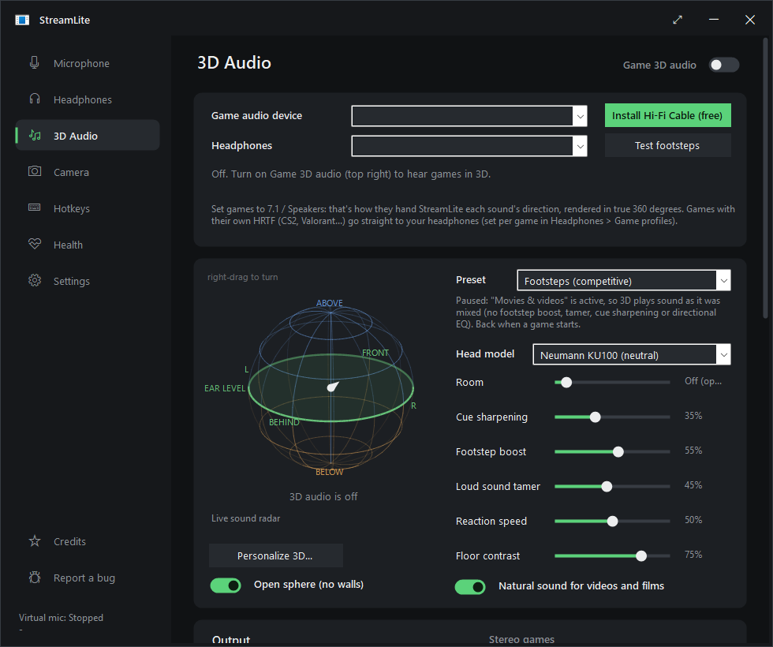

# StreamLite

**A clean mic, 3D game audio and better-sounding headphones - free, for Windows and Linux.**

StreamLite sits between your microphone and Discord, OBS, Zoom, TeamSpeak or your game and removes keyboard clicks,
fans, PC hum, traffic and room noise with AI. It also turns games' 7.1 surround into 3D sound for your headphones,
corrects your headphones to sound neutral, and switches headphone profiles for games, music and voice chat on its own.

**[Download](https://github.com/NermalYT/StreamLite/releases/latest)** ·
**[Manual](https://nermalyt.github.io/StreamLite/)** ·
**[Report a bug](https://github.com/NermalYT/StreamLite/issues/new?template=bug_report.yml)** ·
[Credits](THIRD-PARTY-NOTICES.md)



## What it does

- **Clean microphone.** Voice isolation is built in: DeepFilterNet 3 (studio quality, on your graphics card on Windows)
  takes out fans, keyboards, traffic and even a loud machine next to you. Includes a noise gate, auto level, compressor,
  de-esser and EQ. Apps pick **StreamLite Mic** as their microphone, and your real mic stays usable by other apps.
- **Record a sound to remove (Windows).** A TV, kids or music that noise removal lets through: stay quiet for 8 seconds
  while it plays, and StreamLite learns it and takes it out of your mic.
- **3D game audio.** Games' 7.1 surround becomes 3D sound on any headphones, using real measured heads (SADIE II).
  True 360° placement, footstep boost and a loud-sound tamer. A live **sound cube** shows where sounds come from on
  three floors (below, ear level, above). Right-drag the cube to look at it from any side. **Personalize 3D** (Windows)
  zooms into the cube and turns it into a short first-person listening test that picks the head model and cue settings
  that work for your ears.
- **Headphone correction.** "Find my headphones" looks up your model among thousands of AutoEq measurements and
  flattens it.
- **Automatic profiles.** Each game gets its own headphone EQ. **Music** applies while Spotify plays, **Chat** applies
  while Discord, Zoom, Teams, TeamSpeak, Mumble or another chat app is open, and **Movies & videos** applies otherwise.
- **AI camera (Windows 11).** A "StreamLite Camera" virtual webcam with background blur, AI green screen, face tracking
  and auto light.
- **AI quality (Settings).** One choice for voice isolation and the AI camera: **Low VRAM** (about 210 MB of video
  memory), **Normal** (about 430-490 MB), **High VRAM** (about 860-890 MB, the camera's cut-out at full HD) or
  **Full CPU** (no video memory, slowest).
- **Any headset, any mic.**
  - USB, Bluetooth and analog headsets, audio interfaces and array mics all work.
  - Auto picks the mic input that carries your voice.
  - Each headset keeps its own correction.
  - Plug in or unplug devices and StreamLite follows.
- **Takes care of itself.** It installs the free drivers it needs on Windows, updates itself when it starts, and has a
  **Report a bug** button.

## Install

| System | Download | How |
|---|---|---|
| **Windows 10/11** (64-bit) | `StreamLite-<version>-x64.msi` | Double-click it. Windows SmartScreen may say "Windows protected your PC": click **More info → Run anyway** (StreamLite isn't code-signed yet). |
| Windows, no install | `StreamLite-<version>-win-x64-portable.zip` | Unzip anywhere and run `StreamLite.exe`. |
| **Ubuntu, Debian, Mint, Pop!_OS, Zorin** | `streamlite_<version>_amd64.deb` | `sudo apt install ./streamlite_<version>_amd64.deb` |
| **Fedora, Nobara** | `streamlite-<version>-1.x86_64.rpm` | `sudo dnf install ./streamlite-<version>-1.x86_64.rpm` |
| **openSUSE** | `streamlite-<version>-1.x86_64.rpm` | `sudo zypper install --allow-unsigned-rpm ./streamlite-<version>-1.x86_64.rpm` |
| **Arch, Manjaro, EndeavourOS, CachyOS** | `PKGBUILD` | Put it in an empty folder, then run `makepkg -si` |
| **Any Linux** (one file) | `StreamLite-<version>-x86_64.AppImage` | `chmod +x StreamLite-*.AppImage` and run it |
| **Any Linux** (no root) | `streamlite-<version>-linux-x64.tar.gz` | Unpack it and run `./install.sh`, or use the one-liner below |

One-line install for any Linux distro, for your user only (no password):

```sh
curl -fsSL https://raw.githubusercontent.com/NermalYT/StreamLite/main/packaging/linux/get.sh | sh
```

Linux needs PipeWire (with `pipewire-pulse`) or PulseAudio, which every mainstream desktop has. The packages pull in
everything else.

## Quick start

1. Start StreamLite and pick **your microphone** on the Microphone page.
   - On Windows, click **Install VB-CABLE (free)** if StreamLite asks for it. It's the virtual cable your clean mic
     travels through.
2. In Discord, go to *Settings → Voice & Video* and set **Input Device** to **StreamLite Mic**. Set Discord's own
   noise suppression to **None** and turn off its automatic gain control, so your voice isn't processed twice. OBS, Zoom, TeamSpeak and games work the same way.
3. Optional:
   - **Headphones → Find my headphones** corrects your headphones.
   - **3D Audio** gives games 3D sound. Set the game's audio output to 7.1 / surround.

The [manual](https://nermalyt.github.io/StreamLite/) covers everything else, with fixes for common problems.

## Bugs and ideas

Use **Report a bug** in StreamLite. It's in the sidebar, under Settings, and in the tray menu. It opens the
[bug form](https://github.com/NermalYT/StreamLite/issues/new?template=bug_report.yml) with your version and system
already filled in. You need a free GitHub account. Ideas are welcome
[here](https://github.com/NermalYT/StreamLite/issues/new?template=feature_request.yml).

## Building it yourself

- **Windows:** run `.\build.ps1`. It uses the C# compiler that ships with Windows, so no SDK is needed. Then:
  - `.\install.ps1` installs it for your user.
  - `.\packaging\windows\build-msi.ps1` builds the MSI and the zip. This needs the .NET SDK and WiX 5.
  - `.\test\all.ps1` runs the offline tests.
- **Linux:** run `bash packaging/linux/build-linux.sh`. It needs the .NET 8 SDK. It builds the tarball, .deb,
  AppImage and PKGBUILD, plus the .rpm if `rpmbuild` is installed. After that:
  - `linux/publish/streamlite --selftest` checks the audio path.

Pushing a version tag (`v2.1.0`) makes GitHub Actions do the following:

- Build everything and run the tests.
- Install each Linux package on Ubuntu, Debian, Fedora, openSUSE and Arch.
- Publish the release with `SHA256SUMS.txt`, which the updater checks.

## Credits

StreamLite is built on the work of a lot of generous people:

- RNNoise (Xiph.Org, Mozilla)
- DeepFilterNet (Hendrik Schröter)
- SADIE II (University of York)
- AutoEq (Jaakko Pasanen)
- ONNX Runtime and DirectML (Microsoft)
- Robust Video Matting (ByteDance)
- VB-Audio's virtual cables
- Equalizer APO
- Avalonia, EarTrumpet, Impulcifer and VCamSample

[CREDITS.md](CREDITS.md) lists everything each release uses, with links to the source and the exact model files; the
app shows the same list (**Credits**, above **Report a bug**). Every license is in
[THIRD-PARTY-NOTICES.md](THIRD-PARTY-NOTICES.md).

## License

StreamLite is free software under the [GNU GPL v3 or later](LICENSE). It also grants an extra permission to combine it
with ONNX Runtime, DirectML and Windows; see [THIRD-PARTY-NOTICES.md](THIRD-PARTY-NOTICES.md).
